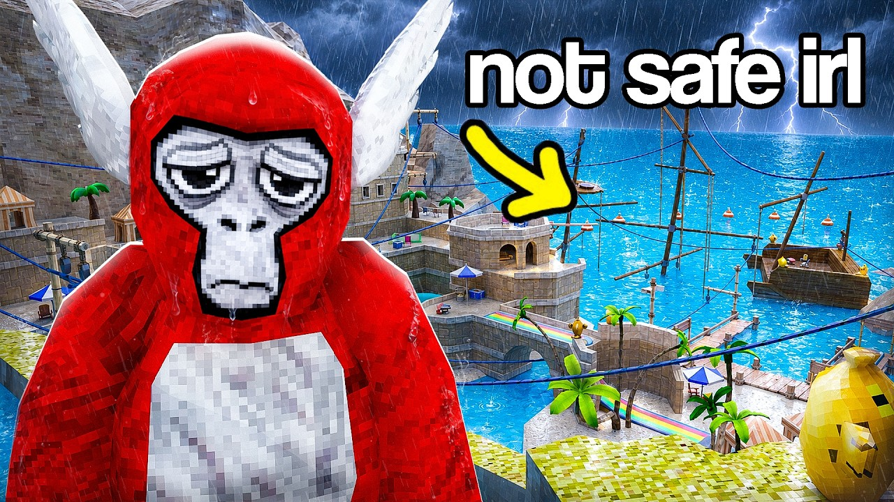

# ThumbGen

Local AI YouTube thumbnail studio for Windows. Invite-only, with a free public beta.

**Website:** https://rhubogen.github.io/thumbgen-ai
**Download:** [ThumbGen.exe (latest)](https://github.com/rhubogen/thumbgen-ai/releases/latest/download/ThumbGen.exe)

## What it does

- **AI backgrounds:** generate scenes from a prompt with style presets.
- **Reference images:** copy the composition, palette or layout of a thumbnail you like.
- **Subject cut-out:** click a person or character to cut it out with an outline.
- **Photoshop-style editor:** layers, masks, blend modes, brushes, selections, crop, curves, history.
- **AI tools:**
  - magic eraser
  - edit text baked into images
  - background remover
  - character generator
  - repaint
  - 4× upscale
- **Export:** JPG (under 2 MB), PNG, WebP or layered PSD, in several sizes at once.
- **Offline:** everything runs on your own PC.

## Install

1. Download `ThumbGen.exe` from [Releases](https://github.com/rhubogen/thumbgen-ai/releases).
2. If Windows shows "Windows protected your PC", click **More info → Run anyway**. The beta isn't code-signed yet.
3. Choose the AI models on first launch. They download once, then ThumbGen works offline.

**Requirements:**
- Windows 10/11 64-bit
- 8 GB RAM (16 GB recommended)
- about 3.5 GB of disk space for the models
- no graphics card needed

## About this repository

This repository hosts the website and the release downloads only. The ThumbGen source code isn't public.

The AI models are downloaded by the app from their original publishers and follow their own licences. Stability AI's SD-Turbo and SDXL-Turbo, for example, limit commercial use; check their licence before using generated backgrounds commercially.

Pro version coming soon.
